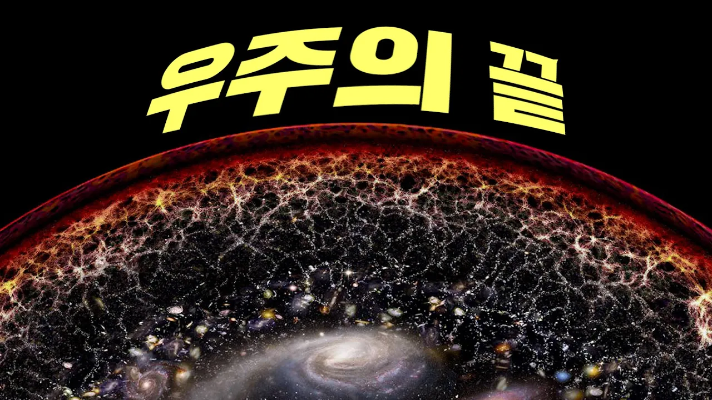

# 우주 끝까지 절대 갈 수 없는 진짜 이유! (10분 순삭)

## 기본 정보
- **URL**: https://www.youtube.com/watch?v=guDoMTahmeo
- **채널명**: 리뷰엉이: Owl's Review
- **구독자수**: 186만
- **조회수**: 8,264,765
- **업로드일**: 2021-10-02
- **영상 길이**: 10:59
- **댓글 수**: 20 (수집 상한 20개까지만 받음)
- **좋아요 수**: 69,556
- **수집일**: 2026-09-08 (경과 1802일)

## 썸네일

---

## 댓글 (추천순 TOP 10)

| 순위 | 좋아요 | 댓글 |
|------|--------|------|
| 1 | 16,000 | 내 마누라 속도 모르는데 어찌 우주의 끝을 알겠는가.. |
| 2 | 1,500 | 리뷰엉이는 이제 진짜 과학 유튜버가 됐구나 ㅋㅋㅋㅋ |
| 3 | 1,200 | "끝" 이라는 말자체가 인간들이 만들낸 말이죠. 인간이 이해가능한 구간을 정해 놓고 거기에 도달하면 끝이라고 하지만 사실 생각해 보면 그 구간을 설정할수 없다면 끝이라는건 없는거죠. |
| 4 | 661 | 우주에 대한 이야기를 들을때면 말로 표현할수 없는 큰공간에 너무나 큰 두려움이 느껴집니다. |
| 5 | 617 | 우주의 끝을 알게되는 것보다 리뷰엉이 채널에서 영화리뷰영상을 다시 볼 날이 더 먼 것 같아요 |
| 6 | 415 | 아무것도 없었다는걸 이해해보고싶네요 |
| 7 | 415 | 저 우주끝에는 돌아가신 아빠 엄마가 행복하게 살아 계셨으면 좋겠어요 |
| 8 | 403 | 우주의 끝에는 진정한 영화 유튜버가 되어있는 리뷰엉이가 있을겁니다 절대 도달할 수 없는 도원향에서 우리를 기다리는 거죠 |
| 9 | 356 | 지금 이 시대에 사는 사람은.. 지구를 탐험하기엔 너무 늦게 태어났고, 우주를 탐험하기엔 너무 일찍 태어났다.. |
| 10 | 333 | 이런 거시적인 세계를 알면 알수록 인간이 얼마나 작은 존재인지 깨닫게 되네요. 그래도 소중한 인류가 먼 미래까지 잘 살아갈 수 있게 우주산업이 많이 발전했으면 좋겠습니다. |
