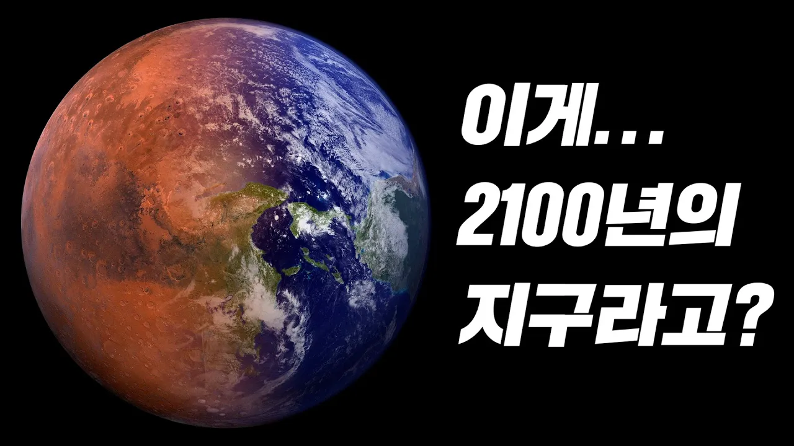

# 이대로 가면 인류는 정말 100년도 안 남았습니다...

## 기본 정보
- **URL**: https://www.youtube.com/watch?v=0aTaZYbg9_s
- **채널명**: 리뷰엉이: Owl's Review
- **구독자수**: 186만
- **조회수**: 6,678,962
- **업로드일**: 2021-04-03
- **영상 길이**: 21:34
- **댓글 수**: 20 (수집 상한 20개까지만 받음)
- **좋아요 수**: 64,440
- **수집일**: 2026-09-08 (경과 1984일)

## 썸네일

---

## 댓글 (추천순 TOP 10)

| 순위 | 좋아요 | 댓글 |
|------|--------|------|
| 1 | 4,100 | 지구:같이해서 더러웠고 다시는 만나지 말자. |
| 2 | 3,600 | 우리나라 출산률 0.8퍼던데 다 환경보호를 위한거였군 |
| 3 | 3,400 | 지구는 멸망하지 않습니다. 지구역사에 인간이 사라질뿐.. |
| 4 | 1,800 | “모든사람이 봤으면 하는 영상 1위” + 좋아요 감사합니다. 우리 모두 환경보호에 관심을 가집시다! |
| 5 | 1,800 | 자연이 많이 바뀐걸 느끼는건 동네에 곤충이 거의 사라지고 모기와 파리만 드글거린다는것.. |
| 6 | 1,100 | 공중파 3사에서 주말 전국민이 보는시간에 방영해야한다고 봅니다. 짝짝짝 |
| 7 | 836 | 본능이 말해주잖아 푸른 숲과 산호초로 가득한 바다가 얼마나 아름다운지. 제발 지키자. |
| 8 | 806 | 독일: 벌목한 만큼 다시 심게함. 그덕에 햇빛도 바닥까지 들어오고 바람도 잘 통하는 건강한 산림을 조성. |
| 9 | 605 | 어렸을때부터 귀아프게 들었던 소리들이지만, 반대로 생각해보면 옛날부터 귀아프게 말해도 사람들이 안들어먹었다는거.. |
| 10 | 448 | 알고리즘님 이영상 한번만 딱한번만이라도 띄워주세요.. |
