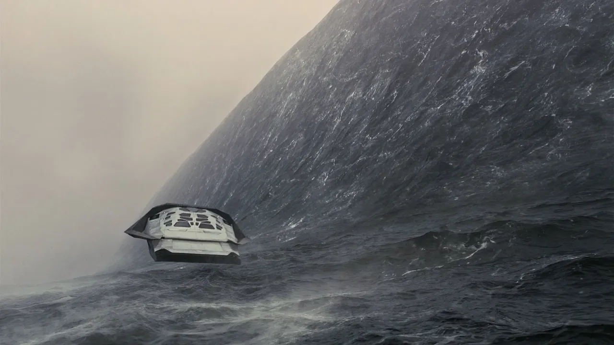

# 파도행성의 3시간이 지구의 23년이라는게 정말 가능할까?

## 기본 정보
- **URL**: https://www.youtube.com/watch?v=OSYsvZSgQF8
- **채널명**: 리뷰엉이: Owl's Review
- **구독자수**: 186만
- **조회수**: 6,382,686
- **업로드일**: 2020-06-24
- **영상 길이**: 8:32
- **댓글 수**: 20 (수집 상한 20개까지만 받음)
- **좋아요 수**: 41,860
- **수집일**: 2026-09-08 (경과 2267일)

## 썸네일

---

## 댓글 (추천순 TOP 10)

| 순위 | 좋아요 | 댓글 |
|------|--------|------|
| 1 | 11,000 | 과학 유튜버로 전향하셨다는 소문 듣고 찾아와봤습니다. |
| 2 | 9,400 | 인터스텔라가 개봉한 2014년으로부터 6년이 흘렀지만, 파도 행성에서는 49분이 지났을 뿐이다. |
| 3 | 6,600 | 시간을 느리게 가게 하는 방법: 플랭크 |
| 4 | 4,500 | 진짜...아인슈타인...대단하다... 우주가 우주의 열쇠에 대한 힌트를 주기위해 만든사람같다 |
| 5 | 2,300 | 아무리 설명을 들어도 이해가 안가는걸 아인슈타인은 어떻게 저런 이론을 생각해낸거고 또 그걸 입증하게 만들다니,,, 정말 인류역사상 전무후무한 천재가 틀림없네요 |
| 6 | 2,100 | 말년병장 : "야~ 나 담달에 제대한다~ 2년이 20년 같았다 휴~" 여사친 : "어머! 벌써 제대해? 군대간지 엊그제 같은데~ 이야~ 시간 진짜 빠르다~" 특수군대성 이론. 군인의 시간은 민간인의 시간보다 개느리게 간다 |
| 7 | 1,600 | ㅋㅋㅋㅋㅋㅋㅋㅋㅋㅋㅋㅋ 솔직히 이번 인터스텔라 설명하는게 후회된다면 다음 영상에서 부엉이를 회전시켜주세요 ㅋㅋㅋ |
| 8 | 994 | 예전의 인터스텔라개봉당시 영화관에서 처음봤을때 파도행성에서 당연히 저멀리는것이 산인줄알았는데 파도로 나오는장면에서 스크린이 엄청높게느껴지는데 이장면이 브금과 찰떡이라 소름이 쫙돋앗음 ㄹㅇ |
| 9 | 922 | 이걸 다보고 내 머릿속에 남는건 부엉이 |
| 10 | 918 | 아인슈타인은 신이 힌트준거같다 진짜 |
