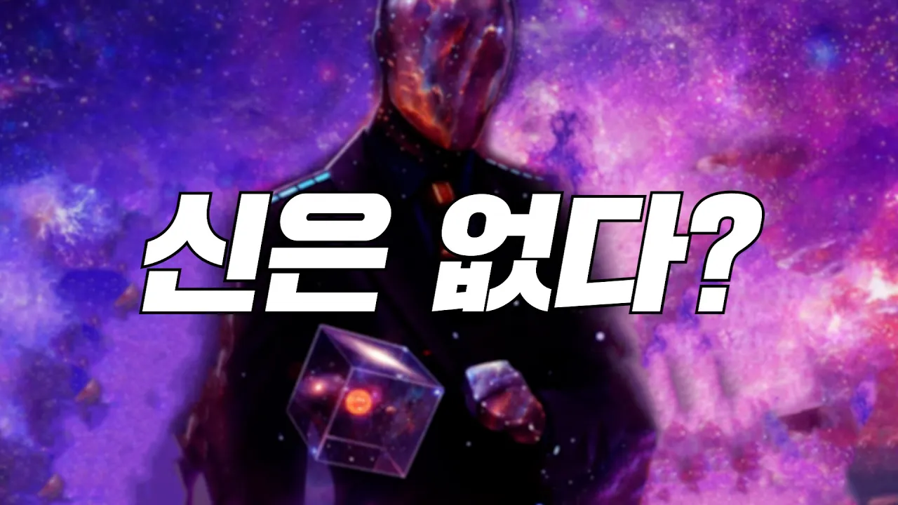

# 신이 존재하지 않는다는 결정적인 증거: 양자역학

## 기본 정보
- **URL**: https://www.youtube.com/watch?v=OTXU-uRxOQI
- **채널명**: 리뷰엉이: Owl's Review
- **구독자수**: 186만
- **조회수**: 6,181,225
- **업로드일**: 2021-01-05
- **영상 길이**: 11:14
- **댓글 수**: 20 (수집 상한 20개까지만 받음)
- **좋아요 수**: 56,931
- **수집일**: 2026-09-08 (경과 2072일)

## 썸네일

---

## 댓글 (추천순 TOP 10)

| 순위 | 좋아요 | 댓글 |
|------|--------|------|
| 1 | 6,300 | 영화 리뷰 채널 “이었던 것” |
| 2 | 5,500 | 리뷰엉이는 과학유튜버와 영화유튜버상태가 동시에 존재하지만 시청자가 관측하는 순간 과학유튜버가 된다. |
| 3 | 3,400 | 이젠 결국 과학채널이 된... |
| 4 | 1,300 | 역설적이게도 세상 모든것은 법칙으로 이루어져 있고 엄청나게 크고 정밀한 톱니바퀴로 맞물려 돌아갑니다. 현대 과학으로는 어떻게 왜 이렇게 이루어졌는지 아직 모르죠. |
| 5 | 646 | 없는지 아무도 증명할수 없다. 하지만 있다고 증명도 못한다 |
| 6 | 618 | 과학을 영화처럼 흥미진진하게 풀어주셔서 넘 감사합니다^^ 한 영상에 얼마나 많은 노력을 들이셨을지 상상이 안되네요~처음에 볼때만해도 영화리뷰였는데ㅋㅋ 이제 과학에 연기까지ㅋㅋㅋ |
| 7 | 612 | 리뷰엉이는 관측되기 전까지는 영화유튜버로 존재하다가, 관측되는 순간 과학유튜버가 된다. |
| 8 | 559 | 뭐야 이젠 영화 비슷하게도 안곁들이네ㅋㅋ |
| 9 | 520 | 이 영상을 보고 확신했습니다. 리뷰엉이는 과학 유튜버구나하고 |
| 10 | 312 | 고전역학이 신이 부정되는 세계관이라 할수 있을거 같은데 양자역학은 오히려 자연의 위대함과 인간이성의 한계와 차원의 벽을 느끼기에 어떻게 보면 신의 존재를 말하기에 근거가 될 만한 개념일지 모른다고 생각한다 |
