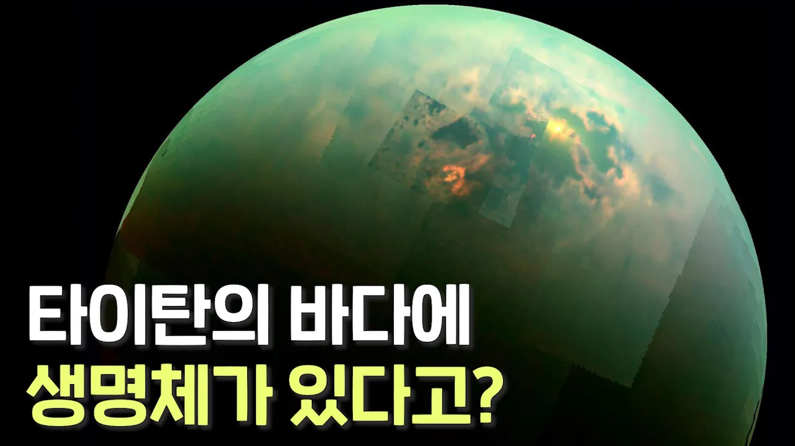

# NASA에 따르면 토성의 달 타이탄에 생명체가 존재할 가능성이 높다고 합니다

## 기본 정보
- **URL**: https://www.youtube.com/watch?v=NpvmJfrkCOY
- **채널명**: 리뷰엉이: Owl's Review
- **구독자수**: 186만
- **조회수**: 5,886,448
- **업로드일**: 2021-12-01
- **영상 길이**: 11:51
- **댓글 수**: 20 (수집 상한 20개까지만 받음)
- **좋아요 수**: 37,740
- **수집일**: 2026-09-08 (경과 1742일)

## 썸네일

---

## 댓글 (추천순 TOP 10)

| 순위 | 좋아요 | 댓글 |
|------|--------|------|
| 1 | 6,000 | 어벤져스 인피니티워 리뷰 감사합니다 |
| 2 | 3,200 | 우리가 제2의 지구라고 불리는 곳들이 사실은 우리보다 더 먼저 생겨나고 먼저 멸망해버린 천체는 아닐까라는 생각이 든다 |
| 3 | 2,500 | 꼭 지금 생명체가 발견되지 않더라도 후대에는 생명체가 나타날 확률이 높은 것 같네요. 생명체를 찾는 게 꼭 멀리서가 아니라 당장 우리 태양계에서도 가능하다니 놀랍습니다. 꼭 나중에 더 밝혀지면 좋겠네요 ㅎㅎ 그나저나 요즘 태양계 생명체 시리즈 잘 보고 있습니다 아주아주 재밌어요 참고로 저는 처음에 리뷰엉이가 과학전문 유튜버인줄 알고 보기 시작했어요 ㅋㅋㅋ |
| 4 | 804 | 타이탄이 원시 지구와 비슷한 느낌인데 인류나 지구의 생명체가 그때까지 있을진 모르지만 몇십억년뒤 타이탄에 지성을 가진 생명체가 나타난다면 인류의 흔적을 발견할지도 모르겠네요 지구에서는 아직 그런 외계생명의 흔적을 발견하지 못했지만 타이탄의 생명체가 우리의 흔적을 발견한다면 진짜 흥미로워 할것같네요 사실 지구의 고대 벽화등도 어쩌면 과거에 외계생명체의 흔적일지도 모르죠 ㅎㅎ |
| 5 | 574 | 타이탄에 잠수함이라니 상상만으로도 웅장이 가슴해지네요ㄷㄷ 꼭 성공해서 공상과학에서나 나오는 미지의 거대 괴수를 봤으면 좋겠네요 서해 보다 최소 7배나 깊은 바다라면 뭔가 기대감이 커지네요 |
| 6 | 446 | 리뷰엉이님 컨텐츠 정말 최고입니다. 예전부터 타이탄에 대해 관심이 많았는데, 이렇게 흥미롭게 영상 올려주시니 정말 감사할 따름입니다. 타이탄 깊은 바다속에는 우리가 알 수 없는 생물체들이 존재하고 있을거라고 항상 생각 하고 있습니다. 얼른 나사 프로젝트가 실현되어 이 미지의 신비를 풀어주었으면 좋겠어요~ |
| 7 | 359 | 영상을 보고 생명이란 단어 자체를 곱씹으니 그 의미가 대단한 것 같네요. 인생을 바쳐서 지구 밖의 생명체를 찾는 생명체들.. |
| 8 | 352 | 원래 영화 리뷰 유튜버 였나요? 전 영화 리뷰보다 이런 쪽에 관심이 많아 얼마전 구독했어요. 아주 유용하고 재밌어서 출퇴근 라디오도 집어치우고 리뷰엉이만 듣습니다. 덕분에 운전 스트레스도 없어지고 어느새 집에 도착. 밤에도 애기들 재우면서 보고있으면 애들도 금방 잠들어있더라고요. |
| 9 | 311 | 대단한 리뷰였습니다 영화'리멤버 타이탄'저도 꼭 정주행해봐야겠네요 |
| 10 | 141 | 리뷰엉이를 포함한 인기유튜버들의 공통점은 바로 좋은 내용만큼이나 듣기 좋은 목소리이다. 음색뿐 아니라 발성, 속도가 오래 오래 들어도 전혀 피곤하거나 질리지 않고 편하다는 것. |
