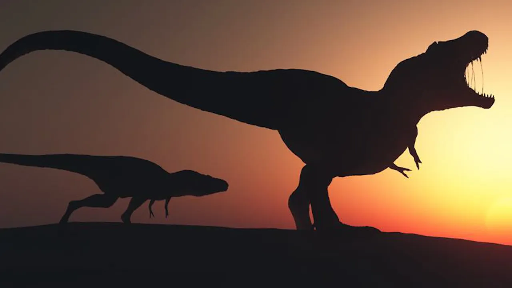

# 공룡이 멸종한 진짜 이유를 찾아낸 과학자들! (12분 순삭)

## 기본 정보
- **URL**: https://www.youtube.com/watch?v=91YPDftXLOc
- **채널명**: 리뷰엉이: Owl's Review
- **구독자수**: 186만
- **조회수**: 4,885,128
- **업로드일**: 2021-03-19
- **영상 길이**: 12:30
- **댓글 수**: 20 (수집 상한 20개까지만 받음)
- **좋아요 수**: 37,362
- **수집일**: 2026-09-08 (경과 1999일)

## 썸네일

---

## 댓글 (추천순 TOP 10)

| 순위 | 좋아요 | 댓글 |
|------|--------|------|
| 1 | 4,100 | "영화리뷰엉이는 과학리뷰엉이로 인해 멸망했다." |
| 2 | 2,500 | 똑같은 지구에 저렇게 다양한 주인공들이 살다 갔다는게 참 신기하기도 하고 우리도 영원한 주인공이 될수없다는 생각도 들고 ...인간의 역사와시간이 얼마나 짧은지도 체감하게 되네요. |
| 3 | 827 | 6500만년 이라는게 진짜 감도안오는 시간이다 |
| 4 | 573 | 형님 3년전부터 봤지만 낯을 많이가려서 댓글은 첨다는 시청잡니다 첨에는 갑자기 과학으로가서 재미없을줄 알았으나 이해가 굉장히 잘되게 설명도 잘하시고 신기하고 재밌는 과학이 주제여서 ㄹㅇ항상 영상 올라올때마다 기대하며 보고있습니다. 만약 조회수가 전처럼 안나와서 영화리뷰로 다시 바꾸신다 하시더라도 전 언제나 과학설명을 기다리겠습니다 화이팅 |
| 5 | 307 | 과학을 알리기 위해 먼저 영화리뷰로 관객을 끌어 모으는 낚시질을 한 대단한 설계자 리뷰엉이 덕분에 오늘도 뜻밖에 과학공부를 하고 갑니다. |
| 6 | 277 | 좀 쎄한게 이렇게 가다가 이 모든것의 시작점인 인터스텔라 까지 갈것같은데 말이죠 ㅎㅎㅎ효 |
| 7 | 212 | 지구의 전체나이를 24시간이라고 가정할때 인류는 24시간의 2초정도라고합니다 그2초만에 인류는 지구를 씹창내는중입니다 대단한 생물이죠 |
| 8 | 153 | 6차 대멸종이 진행 중인걸로 배웠는데요. 과거 대멸종이 몇년에 걸쳐서 진행되는 것이 아닌 몇 만년에 걸쳐 이뤄 진다고 봤을때 현재 멸종사태라 불릴만큼 빠른 속도로 다양한 종이 사라지고 있다고 해요. |
| 9 | 149 | 예전부터 공룡들이 어떻게 멸망하게 됐는지 수 많은 가설들에 대해서 배웠는데 이렇게 왜 멸종해졌는지에 대해 확실하게 정리해주는 영상을 보니 어렸을 적 궁금증이 해소되는 기분입니다. 좋은 영상으로 궁금증을 해결해주셔서 정말 감사합니다. |
| 10 | 130 | 다음영상엔 "인간이살지못하는 지구" 가 나오는 영화장면 몇개 넣으시고 영화유튜버가 되시겠내요 부엉이님ㅋㅋ |
