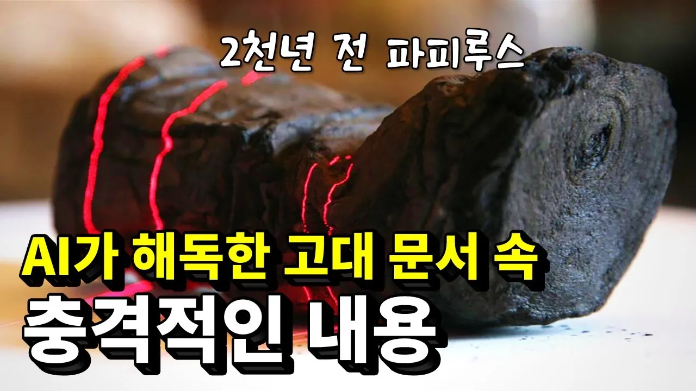

# AI가 읽어낸 2000년 전 고대 파피루스 속 내용

## 기본 정보
- **URL**: https://www.youtube.com/watch?v=_iFXCK5iY1g
- **채널명**: 세모과학
- **구독자수**: 18.5만
- **조회수**: 1,037,918
- **업로드일**: 2024-04-20
- **영상 길이**: 6:39
- **댓글 수**: 20 (수집 상한 20개까지만 받음)
- **좋아요 수**: 9,702
- **수집일**: 2026-09-08 (경과 871일)

## 썸네일

---

## 댓글 (추천순 TOP 10)

| 순위 | 좋아요 | 댓글 |
|------|--------|------|
| 1 | 237 | 정말 대단하다... 고고학은 과학+인문학. 문헌역사학과는 전혀다르다. |
| 2 | 192 | ai와 스캔기술로 헤르쿨라네움의 파피루스를 해독했고 적힌 내용을 토대로 플라톤이 묻힌 장소까지 알아냈다는 뉴스영상을 좀전에 시청했어요. 알고리즘으로 이영상까지 타고들어왔는데 참 신기합니다. 특히 연구결과를 공개하고 챌린지를 걸어 여기까지오게된 배경이 흥미롭네요. 플라톤의 무덤이 실제로 발굴될지, 남은 파피루스에서는 또 어떤 사실을 발견하게될지 기대됩니다. |
| 3 | 192 | 진짜 너무 기대했던 역사 프로젝트 였는데 이제 성공해서 추가로 다른 역사적 사료들에 대한 연구 가능성이 있어서 너무 행복하네여 ㅎㅎㅎ 거기다 파피루스 속 내용이 철학자들의 이야기이다보니 철학덕후 역사덕후로서 너무 기대가 됩니다 ㅎㅎ |
| 4 | 165 | 종이를 펼치지 않고도 읽는 기계를 벌명한 현대문명도 고대문명 못지않게 신비롭긴 하네요... |
| 5 | 140 | 4:55 뭐 별내용은 없지만 파피루스 내용 보시려면 여기부터 |
| 6 | 128 | 화산의 열기로 돌덩이 처럼 변해버린 파피루스 숫덩이를 해독 한다는게 더 신기하다. |
| 7 | 48 | 집단지성의 힘이 정말 대단하군요 |
| 8 | 29 | 조금 더 시간이 흐르면 타버린 종이서류도 증거품으로 내용증명을 하는 시대가 오겠군! |
| 9 | 28 | 아 참 좋은 내용이네요. 덕분에 에피큐로스학파의 정신에 대해서도 알게 되었군요. |
| 10 | 27 | 1417 근대의 시작을 읽어 보길 추천합니다 약2천년전에 쓰인 '사물 본성에 관하여' 루크레티우스 에피쿠로스학파인 책내용은 가히 충격적입니다 |
