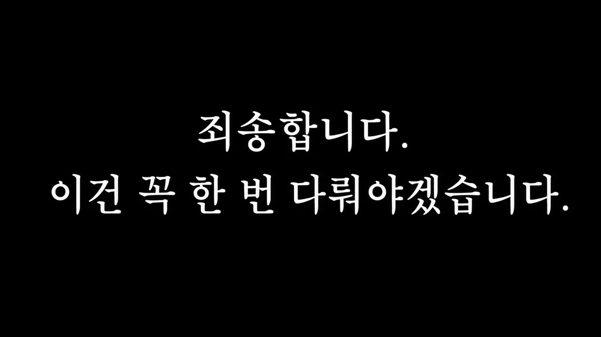

# 한국 고등학생들이 블랙홀 열역학의 20년 난제를 풀어낸 방법

## 기본 정보
- **URL**: https://www.youtube.com/watch?v=6aAbUvef8vA
- **채널명**: 세모과학
- **구독자수**: 18.5만
- **조회수**: 837,226
- **업로드일**: 2026-08-29
- **영상 길이**: 21:40
- **댓글 수**: 20 (수집 상한 20개까지만 받음)
- **좋아요 수**: 5,098
- **수집일**: 2026-09-08 (경과 10일)

## 썸네일

---

## 댓글 (추천순 TOP 10)

| 순위 | 좋아요 | 댓글 |
|------|--------|------|
| 1 | 1,000 | 과학고 교사는 교수 수준임??? 대단하네 |
| 2 | 621 | 2026년6월까지는 이해했습니다 |
| 3 | 575 | 이거 증명하신 영재고 형님 중 한명이 제 물리 올핌피아드 멘토였습니다. 정말 머리 좋으십니다. 말 안됩니다 |
| 4 | 555 | 한국에서도 노벨 물리학상을 받는 날이 오기를 |
| 5 | 480 | 아니그럼 생기부에 난제해결 이런거 쓸수 있는거임? 진짜 씹간지다 |
| 6 | 387 | 한국에서 이런 기초과학 연구의 반가운 소식이, 그것도 고등학교에서 들려왔다는 점이 참 기쁩니다. 오랜 시간 쉽지 않은 문제를 붙잡고 값진 연구를 완성한 안건우, 배이진, 장근영 연구자와 권용준 선생님께 깊은 존경과 감사의 마음을 전합니다. 앞으로의 연구와 도전도 진심으로 응원하겠습니다. |
| 7 | 353 | 뉴스에서 제멋대로 못 한다고 선생님이나 고소하는 몰상식한 인간들만 보다가 이런 훌륭한 학생들과 선생님들을 보니 감격스럽습니다. |
| 8 | 195 | 교수도 아니고 교사가 대단하다. 왜 대단하냐 하면 교사라고 스스로를 낮추지 않고 스스로를 믿고 버티면서 해낸 거니까. 학생들도 마찬가지. 교사를 무시하지 않고 믿고 따랐다는 게 대단. |
| 9 | 160 | 이래서 젊은 피가 계속 유입되어야한다는 것 고정관념을 깨버리는 사람들이 나온다 |
| 10 | 120 | 저걸 발견하고 검증을 마쳤을 때 얼마나 짜릿했을까 연구 하시는 분들은 진짜 대단하심 길을 선택해서 가는 우리와 다르게 길을 개척해 나가는 사람들 |
