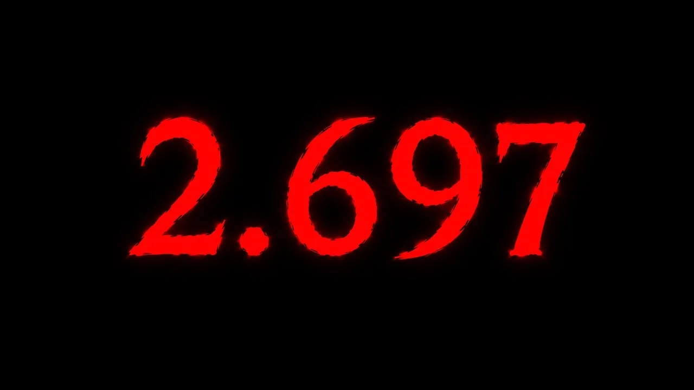

# 아인슈타인의 세계를 무너뜨린 숫자, 2.697

## 기본 정보
- **URL**: https://www.youtube.com/watch?v=qEZ_K5tcoDE
- **채널명**: 세모과학
- **구독자수**: 18.5만
- **조회수**: 808,636
- **업로드일**: 2026-07-05
- **영상 길이**: 12:13
- **댓글 수**: 20 (수집 상한 20개까지만 받음)
- **좋아요 수**: 8,136
- **수집일**: 2026-09-08 (경과 65일)

## 썸네일

---

## 댓글 (추천순 TOP 10)

| 순위 | 좋아요 | 댓글 |
|------|--------|------|
| 1 | 733 | 진짜 신은 주사위 놀이를 한다는 것인가... |
| 2 | 645 | 물리학의 세계가 ㄹㅇ 낭만임 |
| 3 | 422 | 오늘도 2.697 까지만 이해 했구만! |
| 4 | 362 | 100주년 맞춰서 상받은거 감동적이다 아인슈타인은 진짜 천재가 맞는거같다 혼자만의 세계를 완전히 구성하고 하나씩 채워나가는게 진짜 개멋있다. |
| 5 | 165 | 아인슈타인:어제 내 세상이 무너졌어 |
| 6 | 163 | 📌 영상 재밌게 보셨나요? 오늘 영상은 2022년 노벨 물리학상 수상자, 알랭 아스페의 저서 《아인슈타인이 알았더라면》에서 영감을 받아 제작했습니다. ▶ 「아인슈타인이 알았더라면」 만나러 가기📚 교보문고 : https://zrr.kr/AL81k8 예스24 : https://zrr.kr/SYWrSF 알라딘 : https://zrr.kr/08xP4S 개인적으로 이 책이 좋았던 건 단순히 “아인슈타인이 틀렸다”는 식으로 이야기를 끝내지 않는다는 점이었습니다. 오히려 자연스럽게 이런 상상을 하게 만듭니다. “아인슈타인이 정말 이 내용들을  |
| 7 | 100 | 난 저걸 측정할 기구를 구상하는게 너무 대단.. |
| 8 | 95 | 이런 걸 보면 이과의 석학들은 진짜 참 아름다운 자연경관이나 예술작품과 같다는 생각을 지울수 없다.나도 적당히 좋은 머리와 적당히 괜찮은 직업을 갖고 잘 살아가겠지만 한편으론 그들의 지적인 능력이 참 경이롭다. 자신이 갖고있는 수리 과학적 지식과 논리적 사고력을 바탕으로 저런 눈에보이지 않는다는 말로도 부족할 미시세계를 상상하고 연구하고 거기 필요한 이론을 만들고 실제 그 세계에서 일어나는 일들을 검증하고 그중 어떤것들은 법칙이되고.. 그런일들을 지금 이 순간도 이 세상 어디선가 누군가는 사유하고있고 해내고있다는 생각을 하면 가슴이 |
| 9 | 51 | 세모나게 다시 읽어주는 과학 ❤ |
| 10 | 48 | 0:20의 아인슈타인까지 이해했습니다 |
