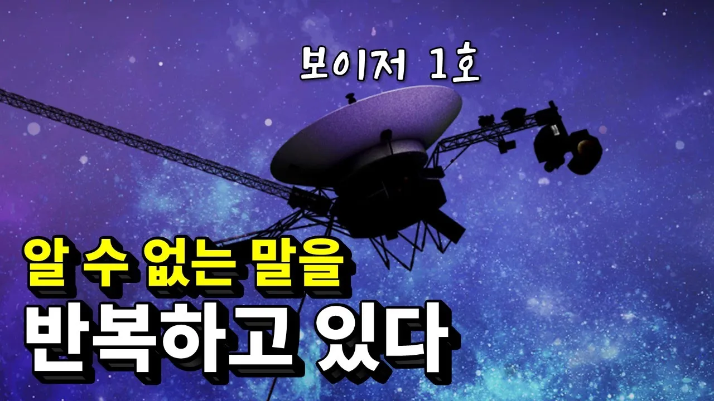

# 보이저 1호로부터 이상한 데이터가 날아오고 있다

## 기본 정보
- **URL**: https://www.youtube.com/watch?v=GJtOwLBzXWw
- **채널명**: 세모과학
- **구독자수**: 18.5만
- **조회수**: 746,337
- **업로드일**: 2023-12-23
- **영상 길이**: 6:05
- **댓글 수**: 20 (수집 상한 20개까지만 받음)
- **좋아요 수**: 7,178
- **수집일**: 2026-09-08 (경과 990일)

## 썸네일

---

## 댓글 (추천순 TOP 10)

| 순위 | 좋아요 | 댓글 |
|------|--------|------|
| 1 | 2,200 | 거의 50년을 퇴근 안하고 일햇는데 50년동안 야근하면 나같아도 그럴듯 |
| 2 | 1,000 | 70년대에 저걸 쏘아올리고 50년동안 버티는 핵전지를 만든 미국은 대체... |
| 3 | 807 | 저렇게 멀리 있는데도 서로 통신이 가능 하다는게 신기함 |
| 4 | 773 | 보이저 1,2호를 쏜다는 소식을 들은지 50년이 다 되어가지만 마치 엊그제 같이 느껴진다. 그러고 보면 언제 내나이가 벌써 이렇게 됐는지 믿겨지지가 않는다. 앞으로 영원히 날아가게 될 보이저들에 비하면 물론 아무것도 아니지만…ㅠㅠ 지금까지 정보를 주고 받았다는 것으로 도 기대 이상이라 무엇을 더 바라겠냐만, 그럼에도 수명이 얼마 안 남았다고 하니 서운하기 그지없다. 1호든 2호든 그동안 수고 많았고 언젠가 내가 이승과 하직하 게 되면 그때는 혹시 만날 수 있을런지… 그때까지 계속 수고하고 그리고 그동안 너무 감사했다. 그동안의 업무 |
| 5 | 488 | 고장 날 때가 이미 넘어섰지요. 미제니까 여태 버틴 것임. |
| 6 | 374 | 기계지만 그 깜깜한 심연의 우주에 혼자서 돌아다니는 게 참. 기계도 카오스가 올듯. |
| 7 | 343 | 아직까지도 보이저1호와 통신이 된다니 놀랍습니다. 원자력 전지의 수명이 다되어 보이저1호의 통신이 끝나간다니 조금 슬퍼 집니다. |
| 8 | 330 | 50년을 날아 갔는데 빛이 하루 걸리는 거리밖에 못 갔다니... |
| 9 | 309 | 0=쉬는날 없다 1=일만한다 ㅅㅂ...니넨 주5일제라며?? |
| 10 | 279 | 보이저호가 날아간 244억km를 빛의속도로 가면 하루도 안걸림... 소름... |
