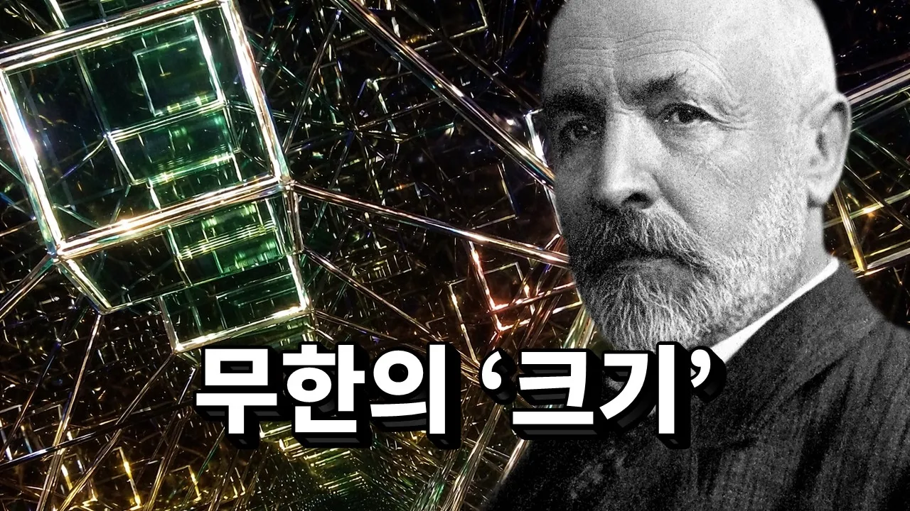

# 신의 영역을 침범해 ‘무한’의 크기를 잰 수학자

## 기본 정보
- **URL**: https://www.youtube.com/watch?v=jvFgSu0G3Cg
- **채널명**: 세모과학
- **구독자수**: 18.5만
- **조회수**: 738,973
- **업로드일**: 2026-02-16
- **영상 길이**: 7:11
- **댓글 수**: 20 (수집 상한 20개까지만 받음)
- **좋아요 수**: 8,984
- **수집일**: 2026-09-08 (경과 204일)

## 썸네일

---

## 댓글 (추천순 TOP 10)

| 순위 | 좋아요 | 댓글 |
|------|--------|------|
| 1 | 544 | 5:14 수학이 이렇게 위험합니다 여러분.. |
| 2 | 357 | 주화입마까지 이해했다 |
| 3 | 303 | 나도 수학자되서 이런거처럼 위대한거좀 하고싶다 |
| 4 | 209 | 이게 칸토어가 천재인 이유죠 칸토어는 수학계의 존재하지 않던 개념을 만들어냈고 무한은 끝없는 것이라 생각 했지만 칸토어는 우리와 다르게 생각하며 그만의 수학체계를 구축했습니다 이것이 천재인 이유입니다 |
| 5 | 205 | 미지의 영역에 도전하는 사람들이 가장 감내해야 할 것은 누구도 이해해주지 않는 것에 대한 외로움일지도. |
| 6 | 184 | 뭐라고 하는지 모르겠다. 그냥 존나 가만히 있어야겠다. |
| 7 | 171 | 세모과학 구독자 여러분 새해 복 많이 받으세요❤️ |
| 8 | 123 | 무한한 숫자 속에도 없는 숫자 라는 개념 진짜 도라이네 |
| 9 | 95 | 무한을 세려는 시도는 진짜로 사람을 미치게 만드는구나 이게 진짜 코즈믹 호러구나 |
| 10 | 78 | 매번 과학,수학으로 시작해서 철학으로 끝나네 그래서 더 좋아요 |
