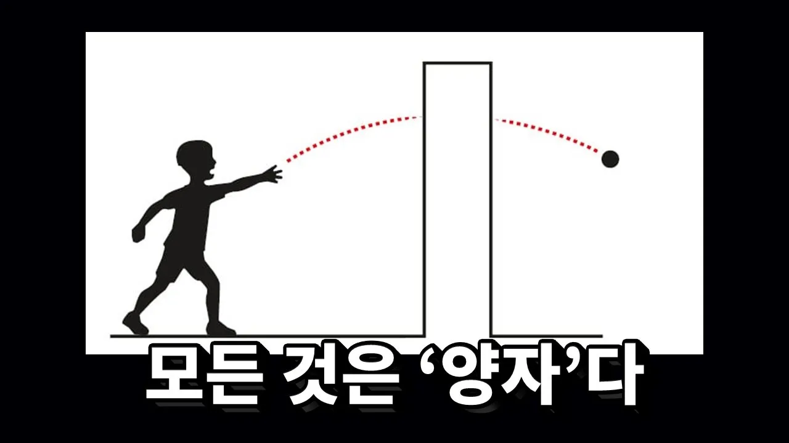

# 2025 노벨 물리학상이 미친 업적인 이유

## 기본 정보
- **URL**: https://www.youtube.com/watch?v=9RZIjo-ut-8
- **채널명**: 세모과학
- **구독자수**: 18.5만
- **조회수**: 684,122
- **업로드일**: 2025-10-19
- **영상 길이**: 7:13
- **댓글 수**: 20 (수집 상한 20개까지만 받음)
- **좋아요 수**: 11,565
- **수집일**: 2026-09-08 (경과 324일)

## 썸네일

---

## 댓글 (추천순 TOP 10)

| 순위 | 좋아요 | 댓글 |
|------|--------|------|
| 1 | 2,900 | 일단 2025 노벨상이 세명의 물리학자에게 돌아갔다 까진 이해 했습니다 |
| 2 | 2,100 | 벽뚫기 버그는 실존한다... 백룸으로 떨어지는걸 조심하도록. |
| 3 | 1,800 | 일단 하나는 확실히 알았습니다. 노벨상 받고싶으면 업적만 있어야 하는게 아닌 오래 살아야 한다는 것을요. 40년 전에 이룩한 업적을 지금에서야 노벨상 준거니까... |
| 4 | 930 | 그러니까 호그와트 가려고 승강장 벽뚫는거도 양자라서 그렇다는거죠? |
| 5 | 588 | ai영상이나 랜덤영상딸깍 안하고 현재 나오는 대사와 확실하게 상관있는 영상이 나오는것만 해도 박수쳐주고싶네용 개추 |
| 6 | 504 | 당신은 나에게 지식을 심는걸 실패했어. |
| 7 | 397 | 난 이거 안다 우리집에 방충만이 있는데도 방안에 엄지 손톱만한 벌레들이 들어와 있다 늘 겪는 일이라 익숙하기까지 하다 |
| 8 | 368 | 완전 초집중해서 7분영상 잘 보았습니다. 보기전의 뇌상태와 지금의 뇌상태가 차이가 1도 없는 터널링을 경험했습니다. |
| 9 | 260 | 김젬마 선생님 저 영상보러 왔어요 |
| 10 | 217 | 양자컴퓨터가 극저온에서 작동하는 이유가 큐빅연산에 필요한 양자터널링과 중첩현상을 유지시키기 위해서였군요 감사합니다 |
