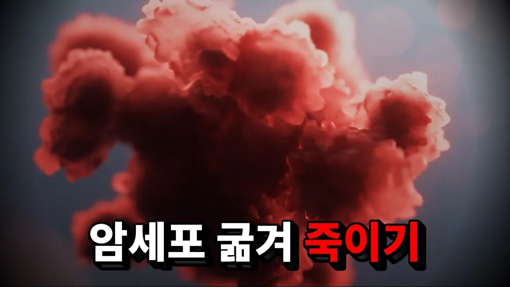

# 과학자들이 찾아낸 암세포를 굶겨 죽이는 방법

## 기본 정보
- **URL**: https://www.youtube.com/watch?v=7tcIoMF6NGM
- **채널명**: 세모과학
- **구독자수**: 18.5만
- **조회수**: 681,000
- **업로드일**: 2025-11-02
- **영상 길이**: 7:09
- **댓글 수**: 20 (수집 상한 20개까지만 받음)
- **좋아요 수**: 13,187
- **수집일**: 2026-09-08 (경과 310일)

## 썸네일

---

## 댓글 (추천순 TOP 10)

| 순위 | 좋아요 | 댓글 |
|------|--------|------|
| 1 | 1,800 | 저런 노력들이 쌓여서 현재 표적치료가 3세대까지 개발되고 이제 4세대로 넘어가는 걸로 알고있습니다 전 3.5세대 정도 치료를 받았고 그 고통은 다른 항암에 비하면 없는 수준입니다 저처럼 20살 때 암에 걸린 사람들도 희망을 가지고 살아갈 수 있습니다. 미래엔 정말 고통없는 치료가 암을 감기처럼 치료할 수 있는 시대가 올거라고 믿습니다. 모든 과학자와 의료진에게 감사할 따름입니다. +다들 응원 너무 감사합니다 저는 뇌에 작은 종양을 수술하고 폐 전이된 놈을 잡고 있지만 꾸준한 운동으로 11년 6개월 만에 어제 암세포가 커지지 않았다는 |
| 2 | 1,700 | 암하고 6년넘게 싸우고 있습니다. 환우 여러분.. 힘냅시다! |
| 3 | 1,600 | 결국 암이란 게 세포 하나 삐끗해서 시작되는 것인데... 평생 암 안 걸리고 사는 게 얼마나 기적 같은 일인지 새삼 느껴짐 |
| 4 | 1,200 | 앞으로 박사과정을 밟게 될 석사생인데 심금을 울리는 대사였습니다. “수많은 실험이 무너지고, 논문이 잊혀지고, 평생을 연구한 연구자가 사라지더라도, 그들이 걸어온길은 결코 사라지지 않는다는 것. 그리고 그 길의 끝에서 새로운 길을 찾는 사람들이 있다는 것” 제가 걷는 이 길이 누군가의 피땀노력이라는 것과, 지금 이 순간에도 각자의 자리에서 열심히 연구하고 계신 모든 연구원 분들이 존경스럽게 느껴지는 영상이었습니다. 감사합니다 |
| 5 | 879 | 엄마도 치료되길 |
| 6 | 840 | 추울때 운동해야되는 이유가 하나 더 늘었네요. 갈색 지방 활성화 |
| 7 | 787 | 이 연구의 제1저자 하이 응우옌 박사(Dr. Hai Nguyen) 는 2024년 11월, 자신의 연구가 완성되기 직전 세상을 떠났습니다. 그는 이번 논문의 핵심 실험을 주도했고, 연구팀은 이 논문을 그에게 헌정했습니다. 그의 연구와 헌신을 기억하겠습니다. Dr. Hai Nguyen, the first author of this study, passed away in November 2024, just before his research was completed. He led the key experiments in this work |
| 8 | 627 | 과학자들이 더 대우받아야한다 진짜로 |
| 9 | 532 | 암, 알츠하이머, 파킨슨... 이런 병들에대한 완벽한 치료법이 빠른 시기에 발견되길 바랍니다.. |
| 10 | 413 | 의학 발달은 정말 잘되고 있습니다 저는 간질환자 입니다 도저히 약이 몸에 안들어서 10년정도 약추가하고 바꾸고해도 전혀 소용이 없었습니다 그러나 신약이 나와서 먹고 거의 새삶을 찾았습니다 포기하지맙시다 |
