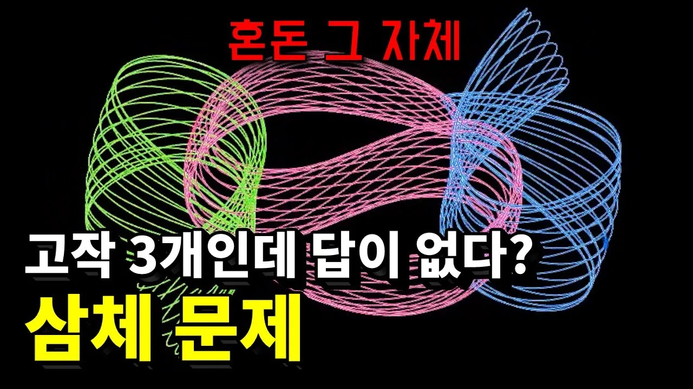

# 천재 물리학자도 포기?! 300년째 풀리지 않는 삼체 문제 (feat. 넷플릭스 삼체)

## 기본 정보
- **URL**: https://www.youtube.com/watch?v=QavFPb4BrSc
- **채널명**: 세모과학
- **구독자수**: 18.5만
- **조회수**: 517,202
- **업로드일**: 2025-01-26
- **영상 길이**: 5:59
- **댓글 수**: 20 (수집 상한 20개까지만 받음)
- **좋아요 수**: 5,227
- **수집일**: 2026-09-08 (경과 590일)

## 썸네일

---

## 댓글 (추천순 TOP 10)

| 순위 | 좋아요 | 댓글 |
|------|--------|------|
| 1 | 1,000 | 이래서 삼각관계가 혼란 그 자체구나 |
| 2 | 645 | 삼체문제의 일반해를 구하는 방식은 사실 엄청 간단합니다. 저는 이 문제에 대한 놀라운 증명을 알고 있지만, 여백이 부족해서 여기 적지 않겠습니다. |
| 3 | 150 | [영상에 오류가 있는 부분이 있어서 고정 댓글 남깁니다] 3:40 해당 부분에서 제가 참고했던 자료는 TED-ed 의 'Newton’s three-body problem explained - Fabio Pacucci' 입니다. TED-ed 자료에서는 '1mm' 라고 표현했지만, 제가 실제 네이처 논문인 'Existence of collisional trajectories of Mercury, Mars and Venus with the Earth' 을 찾아본 결과, '0.3 mas(밀리초각)' 인 것을 확인했습니다. 이는 실제 미터  |
| 4 | 136 | 골디락스 존을 찾기 어려운 이유 단성계도 레어한데 그 좁은 지역을 물을 머금고 안정적으로 공전하는 행성도 많지 않음. |
| 5 | 122 | 그래서 삼체 읽고 보는 내내 이런생각을 했드랬죠.. "얘네들 노답" |
| 6 | 75 | 얼마나 노답이길래 했는데 1:20 보니까 매우 직관적으로 노답인걸 보여주네요;; |
| 7 | 67 | 태양계도 언젠간 망한다지만 우리의 시간에서는 너무 긴시간이라 그냥 현실을 살면됨 |
| 8 | 66 | 게임 코딩같은거 할때 본적이 있던거같은데 float의 오차때문에 시간이 지나서 의도한 값이랑 차이가 나는 경우가 발생함 그 차이가 배정밀도를 쓸때에는 또 달라졌음 우리가 만드는 시뮬레이션 쪼가리도 저 작은 오차가 짧은 시간 안에 큰 변화를 만드는데 하물며 많은 객체가 연속적으로 아주 길게 상호작용하느 우주에서야... |
| 9 | 60 | 이걸 아무리 느리게 설명해도 저는 이해할수 없어요 |
| 10 | 57 | 과학채널중 설명이 가장 깔끔하고 주제도 흥미로워요~! 뜨자마자 보러왔습니다^^ |
