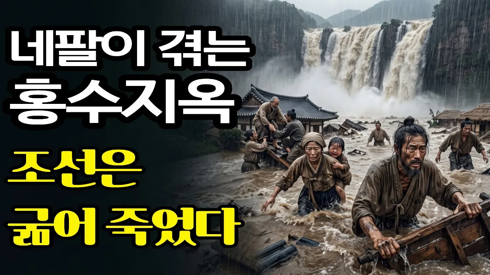

# 네팔이 겪는 홍수지옥, 조선은 이미 겪었다 | 2년의 대홍수, 백만 명은 왜 굶어 죽었을까

## 기본 정보
- **URL**: https://www.youtube.com/watch?v=3kGV9ARhSRQ
- **채널명**: 조선왕조실록이야기
- **구독자수**: 1.77만 (17,700)
- **조회수**: 201,797
- **업로드일**: 2026-09-04
- **영상 길이**: 39:34 (2,374초)
- **댓글 수**: 미확보 (수집 상한 20개까지만 받음)
- **좋아요 수**: 2,864
- **수집일**: 2026-09-09 (경과 5일)

## 실적
| | |
|---|---|
| 조회수 ÷ 구독자 | **11.4배** |
| 일평균 조회수 | 약 40,400회/일 |
| 좋아요율 | **1.42%** (2,864 / 201,797) |

## 썸네일

문구 4줄 — 「네팔이 겪는」(흰) / 「홍수지옥」(흰, 가장 큼) / 「조선은」(노랑) / 「굶어 죽었다」(노랑). 왼쪽 절반이 검은 그라데이션, 오른쪽에 조선 마을을 삼킨 흙탕물.

---

## 댓글 (추천순 TOP 10)

| 순위 | 좋아요 | 댓글 |
|------|--------|------|
| 1 | 38 | 멀리 갈것도 없다 고난의 행군 때 북한은 300만명 굶어 죽었음...김정일은 초 호화 생활을 했음 그 때문에 황장엽이 질려 가지고 한국에 왔음 |
| 2 | 37 | 지금도 그러네요 정치인이 지만 챙기면 국민이 힘들어요 |
| 3 | 33 | 우리나라의과거에그런끔찍한 일이있었다는게 놀라워요 지금의 대한민국은 하늘이 보호하고있어요 |
| 4 | 30 | 굶어죽는데 무슨 자존심 ~~ |
| 5 | 30 | 체면이 자존심이 목숨보다중하냐? 일댠살고봐야지. 벼슬아치들이 문제네 예나지금이나 정치인들이 문제다 |
| 6 | 27 | 이 영상 만드시느라고 많은 수고하심에 감사드립니다. 임금이 나라와 국정을 다스리는데 협력하고 도움이 되어야했을 조정에있던 정치인들은 그 당시나 지금이나 스스로의 의념에 노예가되어 그 많은 인명을 아사로 내몰았네요. |
| 7 | 23 | 가슴아픈 한국사 |
| 8 | 20 | 제작자님!!! 정말수고하셨습니다.듣는내내 너무가슴아파 머엉 합니다. |
| 9 | 19 | 우리나라는 기록의 나라잖아요 조선시대, 목이 달아나도, 임금도 함부로 보지 못했다는 것을 역사가 증명하고 있습니다. |
| 10 | 19 | 수고하셨습니다.잘 들었습니다, |

**TOP 10 중 4개(37·30·30·27 = 2·4·5·6위)가 「벼슬아치·정치인이 백성을 죽였다」**는 같은 말이다. 썸네일과 훅이 판 홍수 이야기가 아니라 **후반의 청나라 쌀 반대 장면**이 댓글을 지배했다. 3위·9위는 「기록의 나라」 — 화자가 본문 내내 반복한 "실록에 그대로 적혀 있어요"에 붙은 반응이다.
