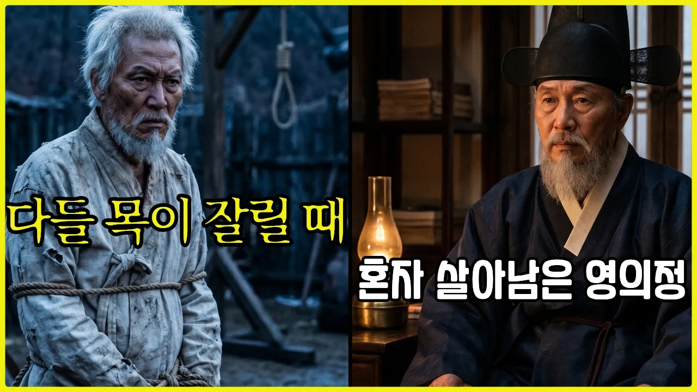

# 조선 왕들은 왜 이 남자를 죽이지 못했을까? (이원익)

## 기본 정보
- **제목(전체)**: 《조선왕조실록》조선 왕들은 왜 이 남자를 죽이지 못했을까?｜영의정들이 목이 잘릴 때, 혼자 살아남은 남자 | 역사 인물 | 조선시대 | 야사
- **URL**: https://www.youtube.com/watch?v=ryfvf6rrlqY
- **채널명**: 조선왕조실록이야기
- **구독자수**: 17,700 (1.77만)
- **조회수**: 145,093
- **업로드일**: 2026-06-14
- **영상 길이**: 41:06 (2,466초)
- **좋아요 수**: 1,140
- **댓글 수**: 총수 미확인 (저장 댓글 20개는 수집 상한이지 전체 댓글 수가 아님)
- **수집일**: 2026-09-09 (경과 87일)

## 실적
| | |
|---|---|
| 조회수 ÷ 구독자 | **8.2배** (145,093 ÷ 17,700) |
| 일평균 조회 | 1,668회/일 |
| 좋아요율 | **0.79%** (1,140 ÷ 145,093) |

## 썸네일

좌우 2분할. 왼쪽 — 밧줄에 묶인 백발 노인, 뒤에 교수대 밧줄, 푸른 냉색 형장. 문구 「다들 목이 잘릴 때」(노랑·검정 테두리).
오른쪽 — 흑립에 검은 도포를 입은 노인이 책과 등잔 있는 서재에 앉음, 따뜻한 주황 조명. 문구 「혼자 살아남은 영의정」(흰색·검정 테두리). 전체를 노란 테두리가 감쌈.

---

## 댓글 (추천순 TOP 10)

| 순위 | 좋아요 | 댓글 |
|------|--------|------|
| 1 | 32 | 이순신을 가장 적극적으로 변호해준 사람은 정탁(좌의정)이었습니다. 물론 이원익, 권율 등도 변호했습니다. |
| 2 | 24 | (채널 고정댓글) "가장 적게 쥔 사람이 가장 오래 살아남았다"는 오리 이원익 대감의 생존 비결, 여러분은 어떻게 보셨나요? 400년이 지난 오늘날, 무한 경쟁 속에서 '더 많이 가져야 안전하다'고 믿는 우리에게 대감의 '빈손'은 어떤 의미로 다가올까요? |
| 3 | 15 | 인생 철학을 어디에 두느냐가 중요 하지 않겠습니까? 경제적으로나 지적으로나 부족함을 느끼면서도 자기 만족을 터득 할 수 있는 높은 견지를 배워야 겠습니다. |
| 4 | 11 | 이원익은 청렴한 관리고 충무공이 옥사로 고문 당할 때 충무공을 목숨걸고 구원했다 |
| 5 | 11 | 모두 중요한 것을 못 배우는군. 오리 이원익 대감의 정신(유훈) 이것이 가장 위대한 유산임을 알아야하며 개인적으로도 자식에게 금전은 한푼 주지말고 정신을 유산으로 남겨라! |
| 6 | 9 | 대동법을 좀 더 일찍 시작했더라면 백성들 고생을 덜 했을텐데 |
| 7 | 7 | 어찌하여 우리는 황희, 맹사성은 알아도 이원익을 알지 못하고 있었는가? |
| 8 | 7 | 님의 역사서를 듣고 감회가 새롭습니다. 잘듣고 구독합니다^~^ |
| 9 | 6 | 이 채널 알고리즘이 잘 일했네요 |
| 10 | 4 | 이원익이 화폐의 주인공이 되어야한다 |

**댓글에서 읽히는 것** — 항의 댓글이 하나도 없다. 1위(32)는 "이순신 변호는 정탁이 더 앞장섰다"는 **보강**이지 반박이 아니다. 7위(7) *"어찌하여 우리는 황희, 맹사성은 알아도 이원익을 알지 못하고 있었는가?"* 가 이 영상이 판 자리를 그대로 말해 준다 — **아는 직책(영의정) + 모르는 이름**.
