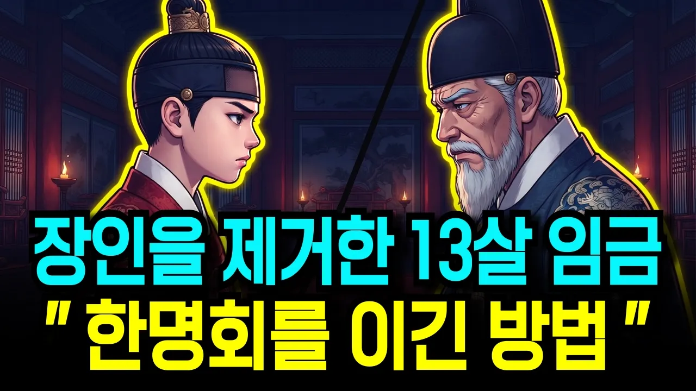

# 13살 조선 왕이 된 소년, 자기를 왕으로 만든 한명회를 무너뜨린 방법

## 기본 정보
- **URL**: https://www.youtube.com/watch?v=6eo5h71aB1Q
- **채널명**: 한밤의 한국사
- **구독자수**: 37,900
- **조회수**: 355,454
- **업로드일**: 2026-08-02
- **영상 길이**: 1:02:55
- **댓글 수**: 총수 미확인 (저장 댓글은 수집 상한 20개. 기존 약 172는 근거 미확보)
- **좋아요 수**: 6,054
- **수집일**: 2026-09-09 (경과 38일)
- **조회수 ÷ 구독자수**: 9.38배
- **좋아요율**: 1.70% (좋아요 ÷ 조회수)
- **일평균 조회수**: 9,354

## 썸네일

---

## 댓글 (추천순 TOP 10)

| 순위 | 좋아요 | 댓글 |
|------|--------|------|
| 1 | 94 | 지금  정치권도 한명회처럼 될 사람이 너무 많다. |
| 2 | 88 | 본인이 지은 죄값을 살아서 받았네.  죄짓고살면 자식들이 단명하는구나.. |
| 3 | 64 | 성종에 대하여 자세히 알게되어 기쁩니다.^^ |
| 4 | 61 | 영원한 권력은 없다. |
| 5 | 54 | 훌륭한 왕이네요  준비하고 다스릴줄 아는 왕이었습니다 |
| 6 | 46 | 단종을 무참히 죽인 한명회가 예종을 죽이지 못할 이유는 없지❤ |
| 7 | 41 | 2026년  지금도 간신 한명회 같은  종자들이 바글바글 하니 나라가 피곤하다 😮😮😮😮😮😮 5년 권력 잡으면 한목챙기는대 집중  하다 끝난다 😮😮😮😮😮😮 |
| 8 | 40 | 설명이 진지하고 진실을 읽으려 애쓰신점 감사드립니다 |
| 9 | 30 | 오죽하면~  조선 왕조를 맘대로 휘두른 죄, 부관참시까지. |
| 10 | 29 | 소리지르지 않고 피 흘리지 않고 조용히 명분을 앞세워 판을 갈아..제도를 합리적으로 ㅡㅡ 와우 |
