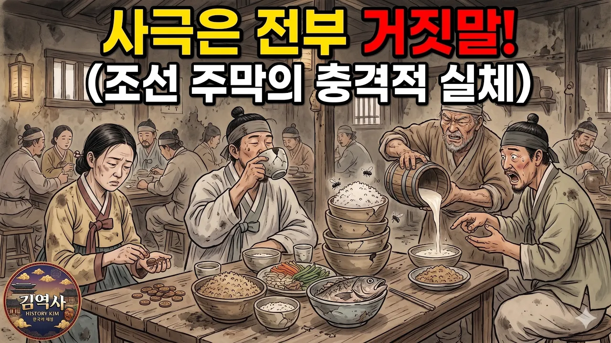

# [김역사의 한국사] 사극이 철저히 숨긴 조선시대 '주막'의 충격적인 진짜 모습 정사 ㅣ 야사

## 기본 정보
- **URL**: https://www.youtube.com/watch?v=76GoBExdKA8
- **채널명**: 지모템
- **구독자수**: 6,850
- **조회수**: 885,169
- **업로드일**: 2026-04-23
- **영상 길이**: 19:18 (1,158초)
- **댓글 수**: 총수 미확인 (저장 댓글은 수집 상한 20개. 기존 약 848은 근거 미확보)
- **좋아요 수**: 11,476
- **수집일**: 2026-09-09 (경과 139일)

## 실적
| | |
|---|---|
| 조회수 ÷ 구독자 | **129.2배** |
| 일평균 조회수 | 6,368회 |
| 좋아요율 | **1.30%** (11,476 / 885,169) |

## 썸네일

문구 2줄 — 1줄 「사극은 전부 거짓말!」(사극은 전부 = 노랑 / 거짓말! = 빨강) · 2줄 「(조선 주막의 충격적 실체)」(흰색). 전부 검은 외곽선.
그림 — 어두운 주막 안. 상 위에 고봉밥 사발 여러 개와 통생선, 그 위로 파리 세 마리. 왼쪽 여인이 지친 얼굴로 엽전을 세고, 가운데 남자가 이 빠진 사발로 술을 들이켜고, 오른쪽 노인이 나무통으로 막걸리를 콸콸 붓자 옆 남자가 입을 벌린다. 뒤로 손님 열댓 명, 얼룩진 벽. 왼쪽 아래 금색 원형 채널 배지(김역사 HISTORY KIM). 채색 일러스트(AI 생성).

---

## 댓글 (추천순 TOP 10)

| 순위 | 좋아요 | 댓글 |
|------|--------|------|
| 1 | 345 | AI영상이지만 잘 만든 것 같습니다. AI에 의지하는 영상과 AI를 이용하는 영상은 극과 극이죠. 정말 감동적인 내용이었습니다. 앞으로 좋은 영상 기대할께요. |
| 2 | 318 | 이세상 제일 살기좋은 시대가 지금입니다.감사합니다. |
| 3 | 104 | 정약용에 대한 것에는 오류가 있습니다. 강진에서는 다산을 존경했고, 주모의 딸이 다산을 모셨습니다. 나중에 다산이 그 여인에게 편지를 보낸것이 발견되었지요. |
| 4 | 84 | 주막은 사라진게아나라 형태를 바꿔 오늘날 선술집 국밥집등 여러모양으로 남아있읍니다ㆍ전통은 사라지지 않읍니다ㆍ |
| 5 | 72 | 전설의 고향에 어김없이 등장하는 주막 ㅎ |
| 6 | 66 | 사극이나 영화볼때 주막은 그냥 식당으로만 알고있었는데 와 저 은행시스템 진짜 지리네. 역시 한국사람들은 머리가 좋은거같다. 저걸 저때부터 생각해 내다니. |
| 7 | 50 | 지금 세상은 진짜 천국이다 감사합니다 |
| 8 | 16 | 단순히 술 한 잔 마시는 곳인 줄 알았던 주막이 사람과 사람을 잇는 거대한 신뢰의 네트워크였다는 사실에 큰 울림을 받습니다. 다산 정약용을 품어준 늙은 주모의 따뜻한 마음이 오늘날 우리 사회에도 꼭 필요해 보이네요. 귀한 역사 이야기 잘 듣고 갑니다. |
| 9 | 14 | 주막을 소재로 하는 영화나 시리즈물이 나옴 흥미진진할것 같아요 사람 냄새가 물신 풍기고 신뢰시스템 또 주모의 삶이 녹여져 나온다면 최고이지 않을까요~즐감했습니다 감사드립니다 ❤ |
| 10 | 13 | 옛날 주막은 정말 이시대 자영업의 근간이었네요...편의점, 마트, 찜질방, 선술집, 포장마차, 숙박, 은행, 현금인출기, 주조장, 우체국, SNS, 도시락테이크아웃, 이 시대 모든 자영업의 근간 이었다는게...특히 신뢰를 바탕으로한 신용 사회이면서도, 외상을주는 정이 넘치는 사회였다는게 우리민족의 똘똘함과 따뜻함이 동시에 느껴졌습니다..... |

**11위 이하에서 참고할 것**
- (10) *"조선후기 인구가 대략 1500만명~2000만명 … 근데 그당시 주막이 십만개라고? … 역사 학자들은 정확한 수는 알수 없으나 여러 상황들을 고려해보면 대략 수천에서 많아봐야 일만개 정도로 추측하고 있음"* — 본문의 핵심 수치(10만 개)를 정면으로 반박
- (7) *"식당+게스트하우스+택배지사+은행+우체국+경찰정보과+신용카드가맹점+전당포"* — 본문의 「오늘날 이름으로 환산」 장치를 시청자가 그대로 따라 함
